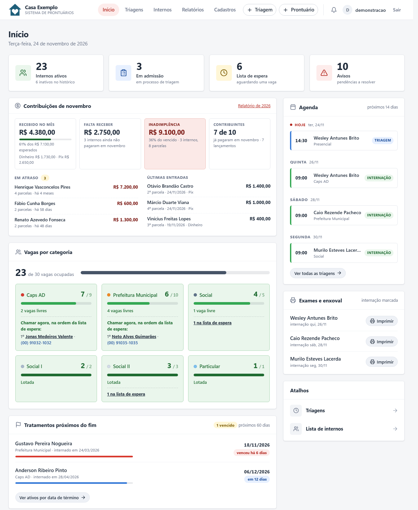
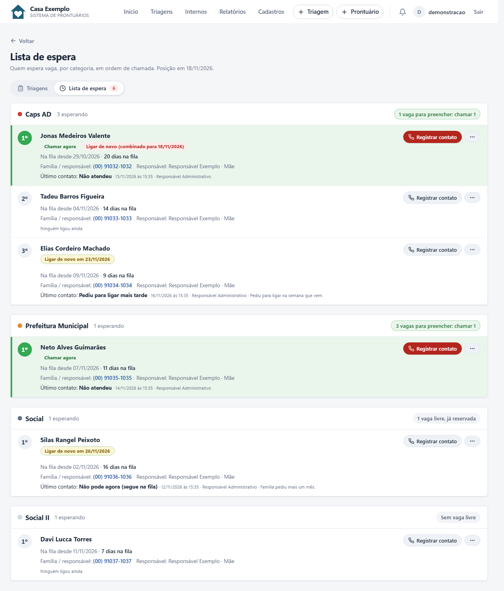
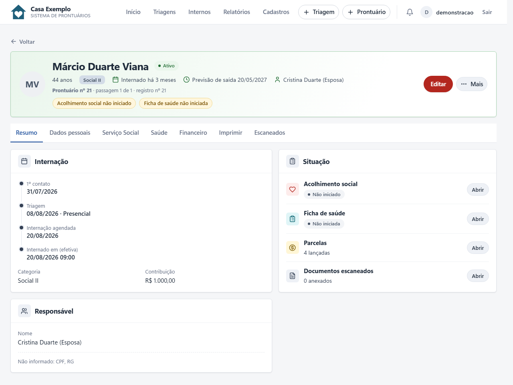
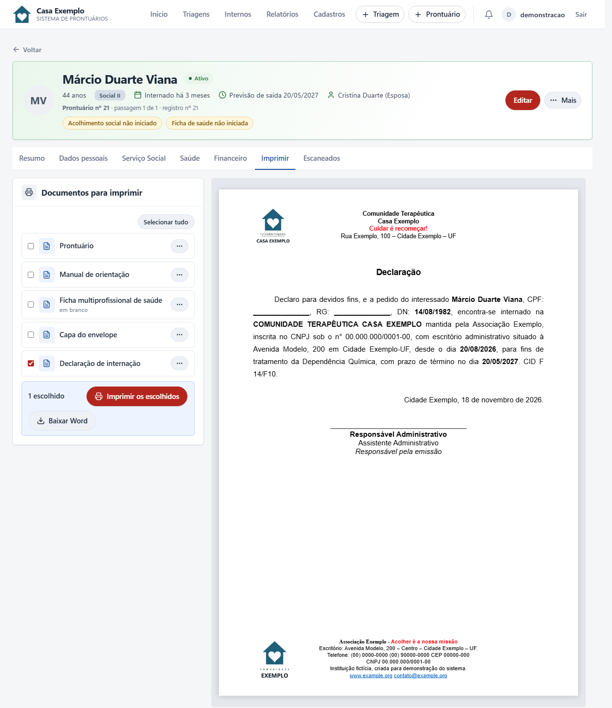
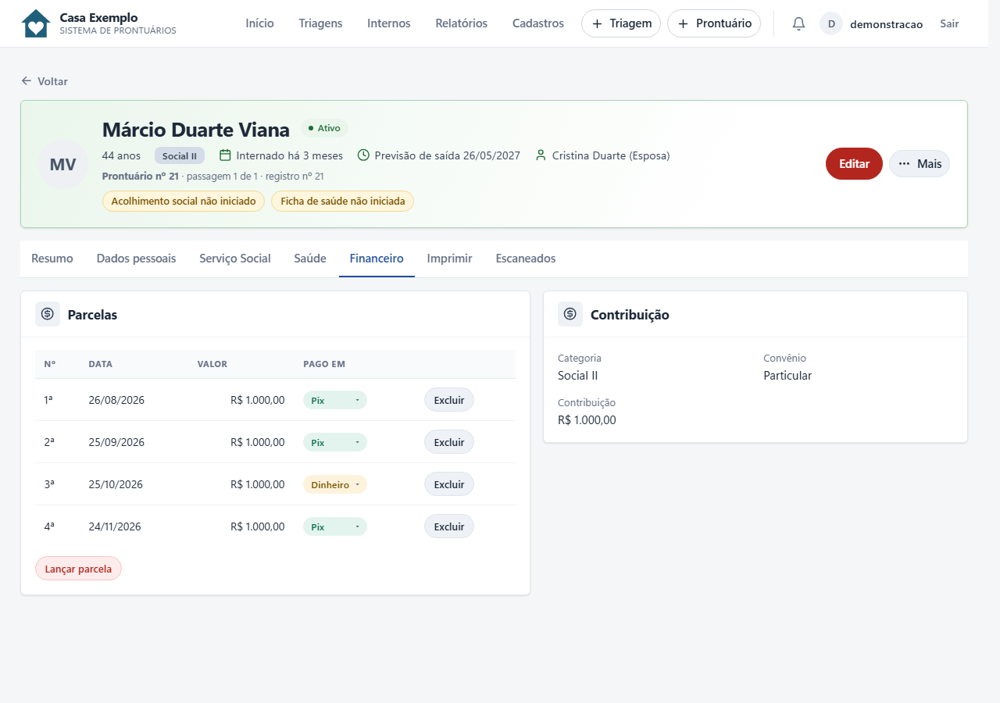
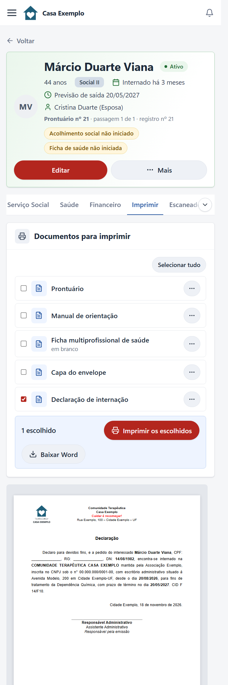
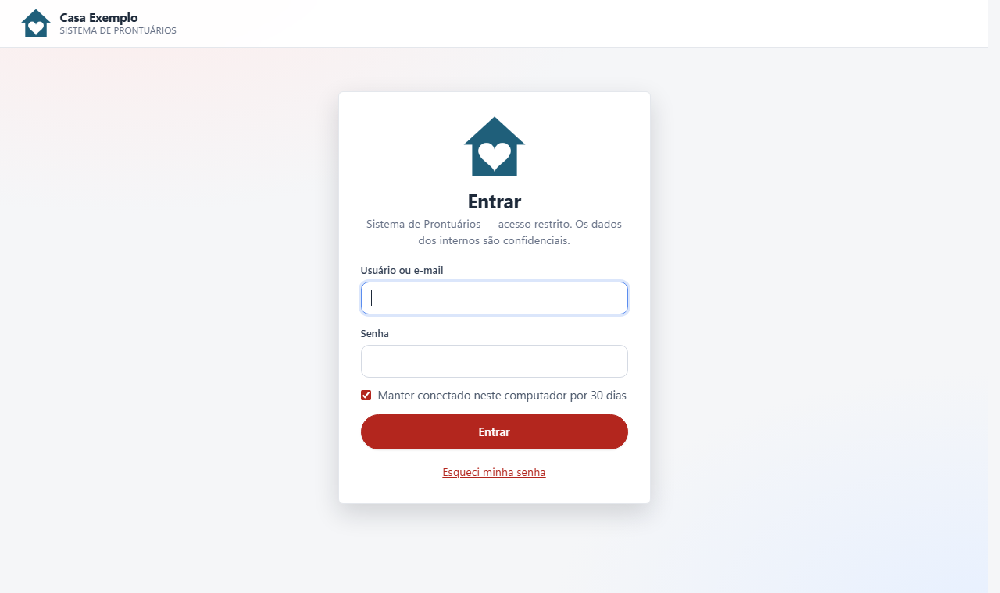

# Sistema de prontuários para comunidades terapêuticas

Aplicação web (Flask) para a rotina de uma comunidade terapêutica: da **triagem** e da **lista de espera** à **internação**, ao **prontuário digital**, aos
**documentos impressos** (em tela e em Word), aos **relatórios** e ao controle das **contribuições**. A interface e os documentos são em português do Brasil.

O sistema acompanha uma instituição fictícia, a **Casa Exemplo**. Não há dados de pessoas neste repositório: o banco nasce vazio no primeiro uso e fica fora do Git.

## Capturas de tela

Dados fictícios e a identidade genérica, *Casa Exemplo*.

**Início**: indicadores, contribuições do mês (com o total recebido em Pix e em dinheiro) e inadimplência, vagas por categoria (com quem chamar da lista de espera), agenda dos próximos dias e tratamentos próximos do fim.



**Lista de espera**: uma fila por categoria em ordem de chamada, com as vagas a preencher e o registro de cada contato.



**Prontuário e documentos**: a ficha em abas por função e, na aba *Imprimir*, os documentos escolhidos numa folha A4 de verdade, com o timbre da instituição (também saem em Word).





**Contribuições**: na aba *Financeiro* da ficha, as parcelas de cada pessoa, com a forma de pagamento (Pix ou dinheiro) escolhida na própria tabela.



**No celular**: a folha A4 continua inteira, só desenhada menor, e a barra de abas ganha o botão ⌄ para as abas que não cabem.



**Entrada**



## O que o sistema faz

**O caminho do acolhido**

- **Triagem** com agenda dos próximos dias e situação de cada pessoa (em admissão, lista de espera, desistência, rejeitada).
- **Lista de espera** com uma fila por categoria (a vaga é por categoria), em ordem de chegada e com ajuste manual. Quando abre vaga, o sistema mostra quem chamar,
  registra cada tentativa de contato com o dia combinado para ligar de novo e avisa no sino e na página inicial.
- **Internação e prontuário digital**: a ficha tem abas por função (Resumo, Dados pessoais, Serviço Social, Saúde, Financeiro, Imprimir, Escaneados), guarda várias
  passagens da mesma pessoa, controla a volta do prontuário em papel depois da baixa e anexa os PDFs dos documentos assinados.
- **Acolhimento social** e **ficha de saúde** (enfermagem): sigilosos, com rascunho salvo automaticamente. Depois de finalizados continuam podendo ser alterados, e cada
  alteração vira uma versão do histórico, que só o administrador vê.

**Documentos**

- Cada documento (prontuário, declarações, manual de orientação, capa do envelope, ficha multiprofissional, pedido de exames, relatórios) é descrito **uma vez** e gera duas
  saídas iguais: uma **folha A4 de verdade** no navegador, para ver e imprimir, e um arquivo **Word (.docx)**, ambos com o timbre da instituição (`documentos.py`).

**Gestão**

- Convênios cadastráveis, vagas por categoria, contribuições por faixa de valor, parcelas com a forma de pagamento (dinheiro ou Pix) e aviso de inadimplência. O Início e o
  relatório do ano mostram o total por forma de pagamento.
- Relatórios (internos ativos por convênio, quem passou pela casa no ano, contribuições), com opção de mostrar só as iniciais.
- Painel inicial com indicadores, avisos e agenda; busca, filtros e páginas feitos no servidor.
- Importação de histórico a partir de planilha, com simulação antes de gravar e relatório do que entrou e do que ficou para conferir.

**Acesso e segurança**

- Níveis de acesso em cascata e permissão por rota (a rota sem regra fica fechada), dois polos de trabalho (Escritório e Saúde) e conteúdo sigiloso só para quem tem a função.
- Senhas: tamanho mínimo, lista de senhas fáceis barradas, bloqueio por tentativas, e-mail confirmado, "esqueci minha senha" e segundo fator por aplicativo autenticador (TOTP).
- Trilha de auditoria (quem fez o quê e quando, sem guardar o conteúdo sigiloso), proteção contra CSRF, política de conteúdo (CSP) e exclusão em duas etapas (lixeira).
- Backup diário do banco e cópia externa **criptografada** em pen-drives em rodízio, com teste de restauração.

## Tecnologia

Python 3.10 ou mais novo, Flask 3, Flask-SQLAlchemy (SQLAlchemy 2), Jinja2 e JavaScript sem framework. Documentos em Word com `python-docx`. Banco SQLite para uso local ou
PostgreSQL por `DATABASE_URL`. Servidor de produção `waitress` (Windows) ou `gunicorn`. Também `cryptography`, `openpyxl` e `segno`.

## Como rodar no seu computador

```bash
python -m venv .venv
. .venv/bin/activate              # no Windows: .venv\Scripts\activate
pip install -r requirements.txt
```

O primeiro usuário é criado na subida a partir de duas variáveis de ambiente (a senha precisa de pelo menos 10 caracteres e não pode ser fácil de adivinhar):

```bash
export ADMIN_USUARIO=admin        # no PowerShell: $env:ADMIN_USUARIO = "admin"
export ADMIN_SENHA='uma frase longa que só você conhece'
python app.py
```

Abra <http://127.0.0.1:5000> e entre com esse usuário. O banco SQLite é criado sozinho em `instance/internos.db` (a pasta `instance/` está no `.gitignore`).
Em vez das variáveis, dá para criar o usuário pelo terminal: `flask --app app criar-usuario nome`.

`python app.py` é só para uso local. Num servidor de verdade o sistema roda com `servidor.py` (waitress) por trás de HTTPS; os roteiros de instalação, atualização, backup e
restauração em um computador Windows estão em [`implantacao/`](implantacao/LEIA-ME.md).

## Identidade da instituição

O nome, as logos, o timbre, os textos dos documentos e o manual de orientação não estão no código: vêm de um **pacote de identidade** (`identidade.py`). O pacote genérico,
*Casa Exemplo*, acompanha o código em `identidades/generica/`. Para outra instituição, copie essa pasta, troque as imagens e os textos e aponte o sistema para ela com a variável
`IDENTIDADE`. Os detalhes estão em [`docs/identidade.md`](docs/identidade.md).

## Estrutura

| Onde | O que tem |
|---|---|
| `app.py` | as rotas; liga as telas às partes abaixo |
| `modelos.py`, `migracoes.py`, `banco.py` | tabelas, ajustes automáticos de banco na subida e escolha do banco |
| `servicos.py`, `prontuario.py`, `vagas.py`, `fila.py`, `contribuicoes.py` | regras de negócio: gravar, classificar por faixa, vagas, lista de espera, contribuições |
| `documentos.py` e módulos de cada documento | o motor que gera a folha A4 e o Word a partir de uma única descrição |
| `autenticacao.py`, `permissoes.py`, `contas.py`, `totp.py`, `auditoria.py`, `csrf.py` | login, níveis e permissões, segundo fator, trilha de auditoria e proteções |
| `backup.py`, `copia_externa.py` | backup do dia e cópia externa criptografada |
| `templates/`, `static/` | telas (Jinja2) e JavaScript sem framework |
| `identidades/` | pacotes de identidade da instituição |
| `implantacao/` | roteiros para instalar, atualizar e restaurar o sistema num servidor Windows |
| `docs/` | documentação |

## Documentação

- [`docs/identidade.md`](docs/identidade.md): como a identidade da instituição funciona.
- [`docs/lista-de-espera.md`](docs/lista-de-espera.md): a ordem de chamada, as vagas e os contatos.
- [`docs/plano-de-seguranca.md`](docs/plano-de-seguranca.md): o plano de segurança, em fases.
- [`docs/polos-e-notificacoes.md`](docs/polos-e-notificacoes.md): os dois polos de trabalho e as notificações.
- [`docs/importacao-historico.md`](docs/importacao-historico.md): a importação de histórico.
- [`docs/padroes-de-interface.md`](docs/padroes-de-interface.md): os padrões visuais das telas.

## Dados e o Git

Os dados de pessoas nunca vão para o repositório. `verificar_vazamento.py` confere, antes de cada commit, se algum dado do banco local foi parar nele; para ligar a conferência
neste clone, rode `git config core.hooksPath hooks`.

## Licença

[MIT](LICENSE).

## Autor

Desenvolvido por Luís ([@luisfernandogrizoni](https://github.com/luisfernandogrizoni)).
